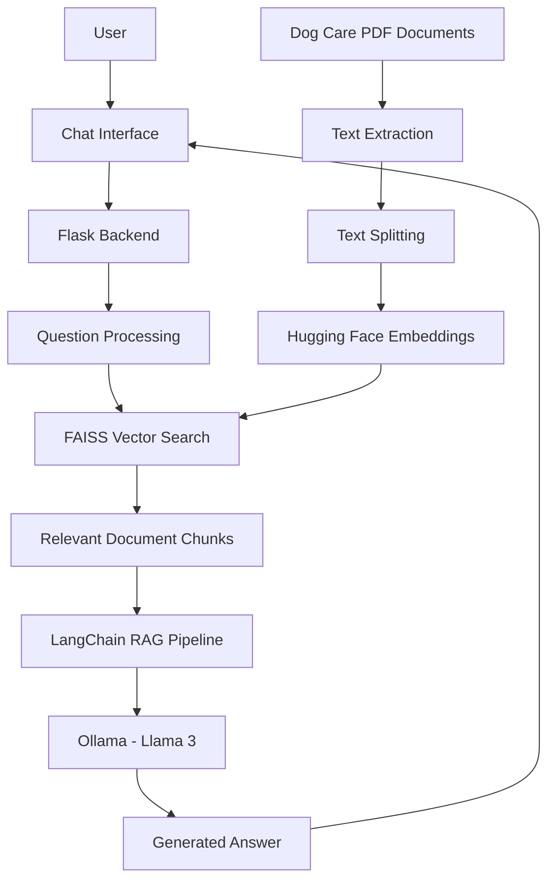

# 🐶 Doggy Care AI Chatbot

An AI-powered chatbot that helps dog owners find useful information about dog health, nutrition, grooming, and everyday care. Doggy Care uses Retrieval-Augmented Generation (RAG) to retrieve relevant information from dog-care PDF documents and generate contextual answers.

## ✨ Key Features

- **AI-Powered Chat:** Ask dog-care questions using natural language.
- **PDF-Based Knowledge:** Retrieves information from dog-care reference documents.
- **Semantic Search:** Finds relevant content using vector embeddings and FAISS.
- **Context-Aware Responses:** Combines retrieved document content with a language model.
- **Interactive Web Interface:** Provides a simple chat experience through a browser.
- **Local Model Support:** Uses Ollama to run the language model locally.

## 🛠️ Technology Stack

| Technology | Purpose |
|---|---|
| Python | Application logic |
| Flask | Backend web framework |
| LangChain | Retrieval and language-model integration |
| Ollama | Local model execution |
| Llama 3 | Response generation |
| FAISS | Vector similarity search |
| Hugging Face | Text embeddings |
| PyPDF | PDF text extraction |
| HTML, CSS, JavaScript | Frontend interface |

## 🏗️ System Architecture



## 🔄 Workflow

1. The user submits a question through the web interface.
2. Flask receives and processes the question.
3. The system searches the indexed PDF content using FAISS.
4. Relevant document sections are retrieved.
5. LangChain provides the retrieved context to the language model.
6. Ollama runs Llama 3 to generate an answer.
7. The response is displayed in the chatbot.

## 📂 Project Structure

```text
Doggy-Care/
├── data/
│   ├── dogfieldcare-manual.pdf
│   └── doginhealthindis00millrich.pdf
├── templates/
│   └── index.html
├── app.py
├── requirements.txt
└── README.md
```

## ⚙️ Installation and Setup

### Prerequisites

- Python
- Ollama
- Llama 3 model
- VS Code or another Python editor

### Step 1: Open the Project

Open the project folder in VS Code and select **Terminal → New Terminal**.

### Step 2: Activate the Virtual Environment

```powershell
.\.venv\Scripts\Activate.ps1
```

### Step 3: Install Dependencies

```powershell
pip install -r requirements.txt
```

### Step 4: Download the Model

```powershell
ollama pull llama3
```

### Step 5: Run the Application

```powershell
python app.py
```

### Step 6: Open the Chatbot

Visit the following address in your browser:

http://127.0.0.1:5000

## 💬 Example Questions

- What are common signs of illness in dogs?
- What foods are suitable for dogs?
- How can I maintain my dog's coat?
- What are the signs of parasites in dogs?
- What should I observe if my dog stops eating?
- What are the basic nutritional needs of a puppy?
- How can I identify changes in my dog's behaviour?
- What information should I provide to a veterinarian?

## 🧠 Core Concept: Retrieval-Augmented Generation

Doggy Care combines document retrieval with language generation.

Instead of relying only on the language model's existing knowledge, the application retrieves relevant text from the supplied PDF documents and uses that context to help formulate answers.

This approach can make responses more relevant to the project's document collection.

## 🚀 Future Enhancements

- Add a larger collection of reliable dog-care resources.
- Display source documents alongside answers.
- Improve handling of questions not covered by the PDFs.
- Add multilingual question answering.
- Introduce conversation history and improved chat controls.
- Enhance the interface for mobile devices.
- Improve document processing and retrieval accuracy.

## 👩‍💻 Project Goal

The goal of Doggy Care is to make dog-care information easier to explore through a conversational interface powered by document retrieval and a locally running language model.
